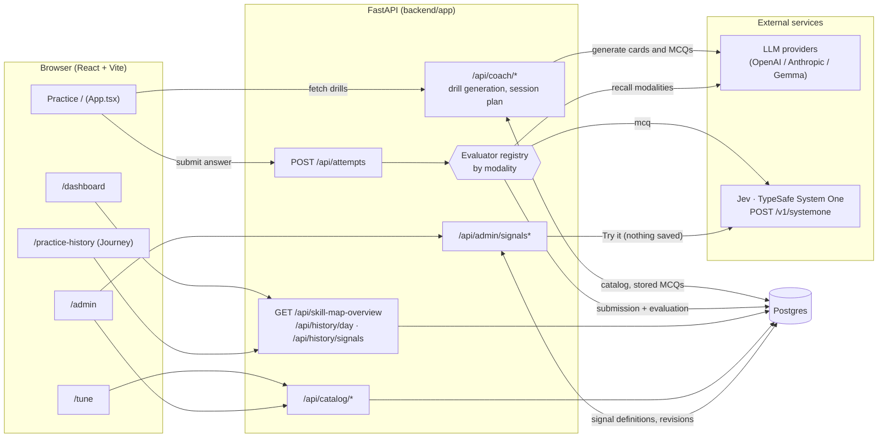
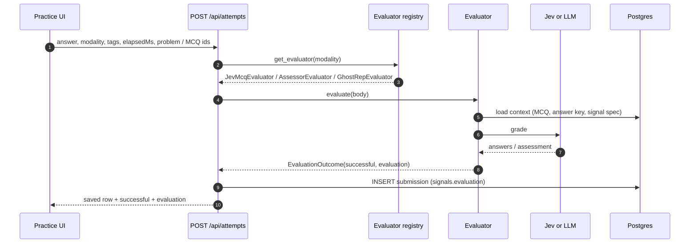
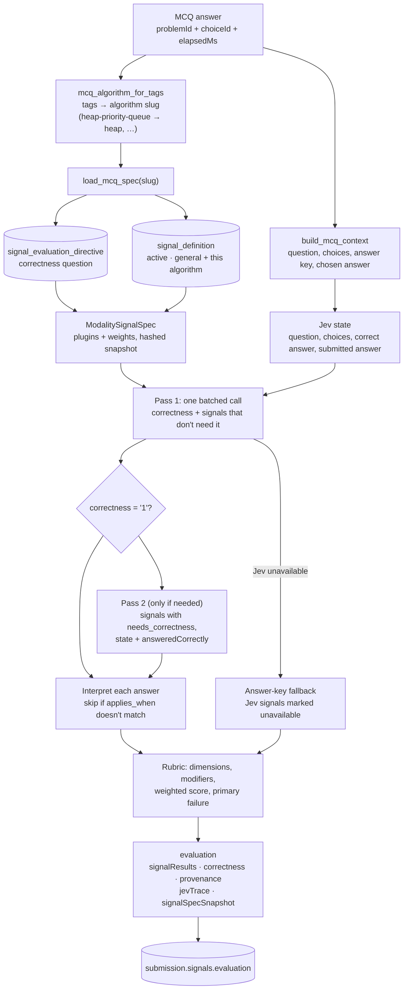
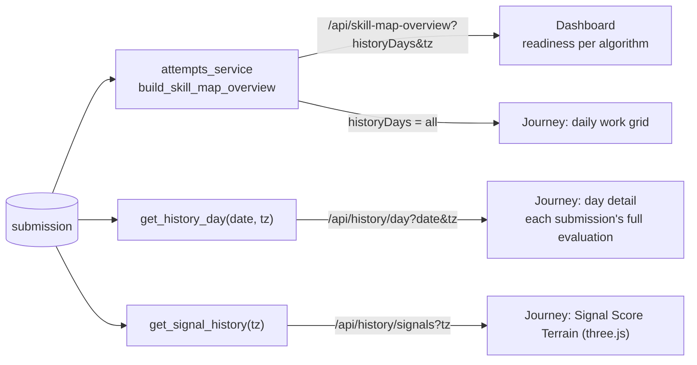
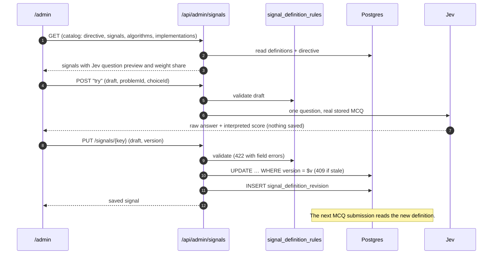

# Data flow

How data moves through System 1: from the practice screen, through the evaluators, into Postgres, and back out to the Dashboard, Journey, Tune and Admin pages. For the tables themselves, see [database-schema.md](database-schema.md). For the backend's layering rules, see [backend-architecture.md](backend-architecture.md).

## The whole system

There are three loops:

1. **Practice:** fetch a drill, answer it, get graded, and store the result.
2. **Review:** the Dashboard and Journey read stored submissions back as readiness, activity and signal history.
3. **Configure:** `/admin` edits the MCQ signals that Jev uses; `/tune` adjusts local practice preferences and shows the recall signal specs.

## 1. Practice: submitting an answer

Every answer goes to `POST /api/attempts`. `submission_service.create_submission` picks an evaluator by the submission's `modality`, then stores whatever the evaluator returns.

| Modality | Evaluator | Grades with |
|---|---|---|
| `mcq` | `JevMcqEvaluator` (`services/evaluators/jev_mcq.py`) | Jev, using the DB-backed signal registry |
| `total-recall`, `microdrill` | `AssessorEvaluator` (`services/evaluators/legacy_recall.py`) | LLM assessor and narrator, falling back to the semantic check |
| `ghost-rep` | `GhostRepEvaluator` (same file) | Semantic recall check against the algorithm's signal spec |

Adding a modality means writing a class with an `evaluate(body)` method and calling `register_evaluator` for it. Nothing else changes.

## 2. MCQ grading with Jev

This is the path that is now fully data-driven. All signal definitions live in the database and are read on every submission.

Key points:

- **One question per signal.** Each Jev signal becomes one Choice, Score or Noul question. All of them go out in a single `POST /v1/systemone` call.
- **Correctness is a Jev question too.** It is a Choice with the labels `"1"` and `"0"`. The answer key is still checked: if Jev disagrees with it, the evaluation is flagged `answer_key_disagreement`. Low confidence is flagged `low_correctness_confidence`.
- **A second call happens only when needed.** Signals marked `needs_correctness` are asked after correctness is known, with `answeredCorrectly` added to the state.
- **Deterministic signals** (for example `completionTime`) are computed locally and never sent to Jev.
- **Failures degrade, they don't block.** If Jev is down, the answer key decides correctness and the Jev-backed signals are recorded as `unavailable`.
- **Every evaluation is explainable later.** It stores the exact spec snapshot and hash, Jev's request ids, the model and the raw answers.

## 3. Review: Dashboard and Journey

- The browser sends its IANA time zone (`tz`), so "today" and day boundaries match what you see.
- The terrain plots signals (x) over time (y), with height showing how far each signal fell short. It is built from the stored rubric dimensions and modifiers, not by asking Jev again.
- The day detail renders the stored evaluation as is (`SubmissionSignalDetails.tsx`), including the Jev trace.

## 4. Configure: editing signals in /admin

## Drill generation (for completeness)

Practice cards come from `/api/coach/*`:

- Catalog drills (`problem-drills`, `playlist-drills`) are read straight from the seeded catalog.
- Generated drills (`skill-map-drills`, `skill-map-drills-stream`, `micro-drill`, `multiple-choice-drills`) call the configured LLM provider. Generated MCQs are stored in `multiple_choice_problem`, deduplicated by fingerprint, so an MCQ answer always has a stored answer key to check against.
