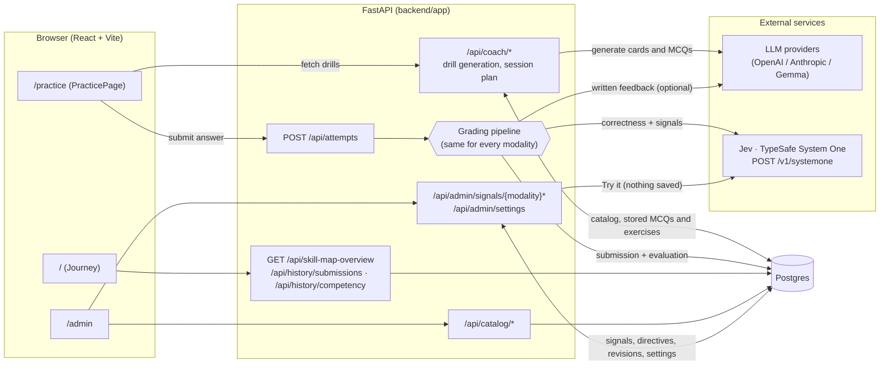
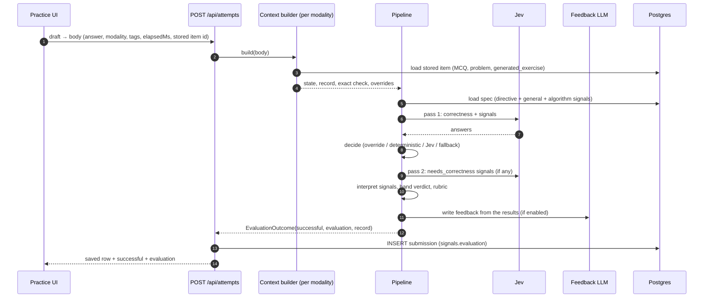
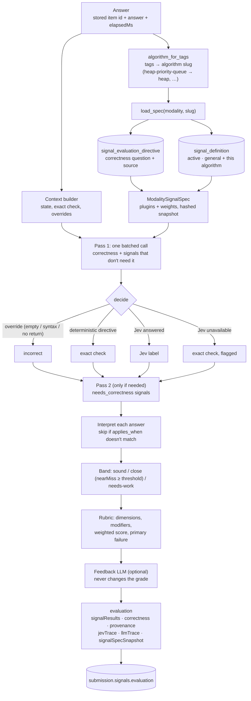
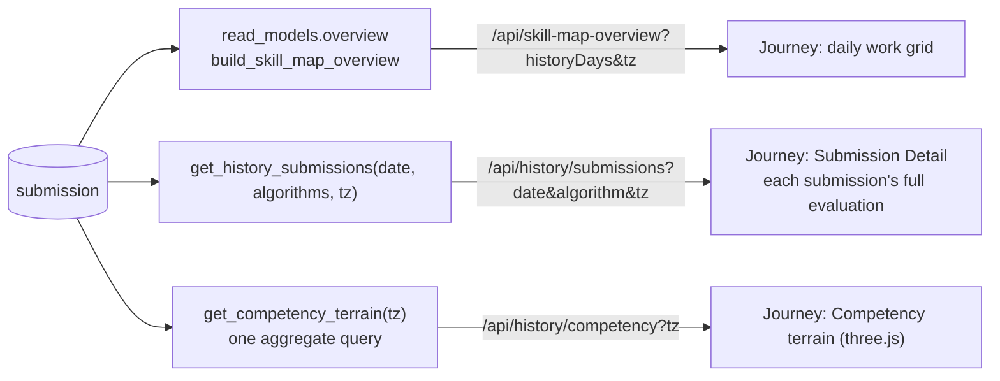
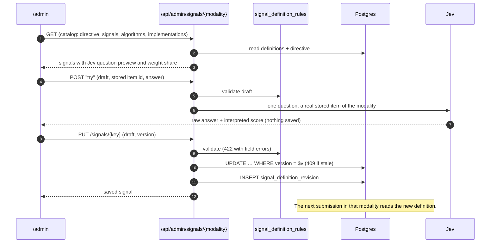

# Data flow

How data moves through System 1: from the practice screen, through the grading pipeline, into Postgres, and back out to the Journey and Admin pages. (Tune only edits personal editor and hotkey preferences stored in the browser.) How grading decides is in [grading.md](grading.md). For the tables themselves, see [database-schema.md](database-schema.md). For the backend's layering rules, see [backend-architecture.md](backend-architecture.md).

## The whole system

There are three loops:

1. **Practice:** fetch a drill, answer it, get graded, and store the result.
2. **Review:** Journey reads stored submissions back as competency, daily activity and each day's evaluations.
3. **Configure:** `/admin` edits every modality's correctness question and signals, and the server-side grading, generation and practice settings. `/tune` adjusts personal editor and hotkey preferences stored in the browser.

## 1. Practice: submitting an answer

Every answer goes to `POST /api/attempts`. `submission_service.create_submission` runs the one grading pipeline (`services/evaluation/pipeline.py`) and stores what it returns. Only the context builder and the signal spec differ by modality.

| Modality | Graded against | Correctness decided by | Jev calls |
|---|---|---|---|
| `mcq` | stored `multiple_choice_problem` | Jev (answer key flags disagreement; fallback) | 1–2 |
| `total-recall` | stored `problem` reference | Jev, after code-check overrides | 1–2 |
| `ghost-rep` | the target typed over | exact typed match (deterministic directive) | 0 |
| `microdrill` | stored `generated_exercise` | Jev, after code-check overrides | 1–2 |
| `ladder` | stored `generated_exercise` | Jev, after code-check overrides | 1–2 |

On the frontend every modality hands the same `useSubmission` hook a draft (`features/practice/modalities/*/draft.ts`), and one `EvaluationResult` view shows what comes back. Adding a modality is a context builder, a defaults module and a draft builder: see [grading.md → Adding a modality](grading.md#adding-a-modality).

## 2. Grading with Jev, in detail

All signal definitions live in the database and are read on every submission, for every modality.

Key points:

- **One question per signal.** Each Jev signal becomes one Choice, Score or Noul question. All of them go out in a single `POST /v1/systemone` call.
- **Correctness is a Jev question too**, unless the directive says the modality's own check decides (Ghost). For MCQ the answer key is still checked: disagreement is flagged `answer_key_disagreement`. Low confidence is flagged `low_correctness_confidence`.
- **Code is never run.** Empty, unparsable or return-less code is incorrect whatever Jev says (`deterministic_override`).
- **A second call happens only when needed.** Signals marked `needs_correctness` are asked after correctness is known, with `answeredCorrectly` added to the state.
- **Deterministic signals** (for example `completionTime`, `syntaxValid`) are computed locally and never sent to Jev.
- **Failures degrade, they don't block.** If Jev is down, the exact check decides correctness and the Jev-backed signals are recorded as `unavailable`.
- **Every evaluation is explainable later.** It stores the exact spec snapshot and hash, Jev's request ids, the model and the raw answers.

## 3. Review: Journey

- The browser sends its IANA time zone (`tz`), so "today" and day boundaries match what you see.
- The terrain plots competency per algorithm (x) per day (y); height is competency, so peaks are strong. One aggregate query (`attempts_repository.fetch_competency_terrain`) computes all of it from the stored evaluations, not by asking Jev again:
  - each counted submission belongs to one algorithm, the one named by its first matching tag (`taxonomy.primary_algorithm_slug`; the daily grid and the submission list use the same rule, so every Journey view counts an answer in the same place; the tag → algorithm table, aliases included, is passed in as a parameter);
  - a day's competency is the average of every scored rubric entry (dimensions and modifiers, including correctness and speed) from that algorithm's answers, in the viewer's time zone;
  - each day after that without practice carries the last practised day's value, decayed by the *competency decay* setting (default 2%, compounded): `last × (1 − decay)^days since`;
  - each row also carries the last practised day's average, the days since, and a **standing**: `strong` (competency ≥ 70), `learn` (the last practised average was already below 70: never got good) or `review` (it was above 70 and has decayed);
  - `free_fall` is true after more than *free-fall days* (Admin setting, default 10) without practice;
  - rows run from each algorithm's first practice to today.
- `fetch_competency_overall` averages every practised algorithm's competency per day (the terrain query, grouped by day) for the Overall row, with the change since 7 days earlier (`LAG`, or since the first day with less history) and its trend: improving above +2 points, regressing below −2, maintaining otherwise.
- Another aggregate query (`fetch_competency_signals`, sharing the same CTEs) averages each signal per algorithm over all time and returns the 3 strongest and 3 weakest; with fewer than 6 signals they are split between the two sides, never repeated.
- The response also lists known algorithms and playlists with no answers (`unpractised`). The browser only draws all of it: the terrain and the ranked list with its expanded rows read this one response.
- The Submission Detail renders the stored evaluation as is (`SubmissionSignalDetails.tsx`), including the Jev trace. Choosing a day asks for that day; choosing algorithms with no day asks for their submissions over the last year; both narrows the day.

## 4. Configure: signals and settings in /admin

Settings (`GET/PUT /api/admin/settings/{section}`) work the same way: one versioned `app_setting` row per section, 422 with field errors, 409 if stale. The pipeline and generators read them on each request; the practice screen reads its section from `/api/catalog/practice-settings`.

## Drill generation (for completeness)

Practice cards come from `/api/coach/*`:

- Catalog drills (`problem-drills`, `playlist-drills`) are read straight from the seeded catalog.
- Generated drills (`skill-map-drills`, `skill-map-drills-stream`, `micro-drill`, `multiple-choice-drills`) call the configured LLM provider. Generated MCQs are stored in `multiple_choice_problem`, deduplicated by fingerprint, so an MCQ answer always has a stored answer key to check against. Microdrills and Ladder rungs are stored in `generated_exercise`, and their answers are graded against the stored copy.
