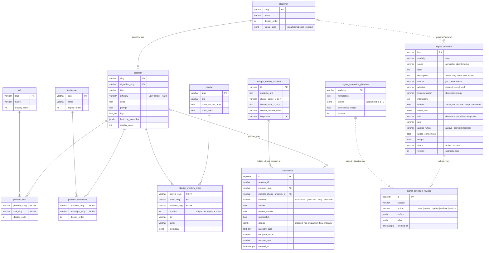

# Database schema

Postgres, defined in [`backend/app/schema.sql`](../backend/app/schema.sql). The backend applies that file at every startup (every statement is `IF NOT EXISTS`), then runs the small, idempotent upgrades in `_apply_schema_upgrades` (`backend/app/database.py`) and seeds the catalog and the default MCQ signals. There is no separate migration tool.

The tables fall into three groups:

- **Content catalog:** what you practice. Seeded from code on every boot.
- **Practice records:** what you did. Written by `POST /api/attempts`.
- **Signal registry:** how MCQ answers are graded by Jev. Seeded once (insert-if-missing), then owned by `/admin`.

## Entity relationships

Solid lines are foreign keys. Dotted lines are references by value that the database does not enforce.

## Content catalog

| Table | Holds | Written by |
|---|---|---|
| `algorithm` | One row per algorithm family (sliding window, heap, …). `signal_spec` is the recall signal spec used by the legacy LLM evaluators. | Seed on every boot (overwrites) |
| `problem` | A practice card: its code, prompt, hint and tags. Every problem belongs to one algorithm. | Seed |
| `skill`, `technique` | Finer-grained labels. | Seed |
| `problem_skill`, `problem_technique` | Many-to-many links from problems to skills and techniques. | Seed |
| `playlist`, `playlist_problem_order` | Ordered decks of problems. A playlist can have several named orders (`order_slug`). | Seed |
| `multiple_choice_problem` | A generated MCQ with up to four choices and the answer key. `fingerprint` deduplicates identical questions. | Generated during practice |

### Content rules

- **`problem` is the single home for practice content:** core algorithms, meta questions, static playlist cards and generated cards. Do not add another table that stores titles, prompts, code, difficulty or tags; the architecture tests guard this.
- **`source_type` records where a row came from:** `core-catalog`, `core-meta`, `static-playlist` or `generated-llm`. Generated cards are written straight to `problem`, with `generation_context` and `llm_used`.
- **Playlists only organize:** `playlist` and `playlist_problem_order` reference problems by slug and never copy their content.
- **Submissions keep a snapshot:** `submission.generated_card` stores the card exactly as shown, so history renders correctly even if the problem later changes.
- **Resetting practice history** deletes `generated-llm` problems but never core or playlist rows.
- **MCQs are separate on purpose:** they live in `multiple_choice_problem`. A stored question is never edited, so every MCQ answer can be checked against what was shown.
- The Python and TypeScript catalogs in code (`backend/app/core/*catalog*.py`, `src/data/`) are seed inputs and offline fallbacks; reads at runtime go through the repositories.

## Practice records

`submission` is the only table practice writes to. One row per answer, across every modality.

- `modality` picks the evaluator (see [data-flow.md](data-flow.md)).
- `problem_slug` links recall-style answers to a catalog problem. `multiple_choice_problem_id` links MCQ answers to their question.
- `signals` is a JSONB object, and a CHECK constraint allows only these keys:
  - `elapsed_ms` (required, a number)
  - `evaluation`: the canonical evaluation. For MCQ this includes `signalResults`, `correctness`, `provenance`, `jevTrace` and a `signalSpecSnapshot`, so a stored grade can always be explained even after the signals change.
  - `flow`: flow-mode bookkeeping (`anchorCardId`, …)
  - `modality`: modality-specific extras
- The Dashboard and Journey pages read from this table. The Journey day view groups rows by date in the viewer's time zone.

## Signal registry

These three tables make MCQ grading data-driven. See [backend-architecture.md](backend-architecture.md) for the code side.

- **`signal_definition`:** one row per signal. A signal is either a Jev question (`source = 'jev'`, with a `primitive`) or a deterministic implementation registered in code (`source = 'deterministic'`, with an `implementation` such as `completionTime`). The `signal_definition_source_fields_check` constraint enforces that split.
  - `scope` is `general` (applies to every MCQ) or an algorithm slug (applies only to that algorithm's MCQs). It is checked in code, not by a foreign key.
  - Signals are archived, never deleted: past evaluations refer to their keys.
  - Every write must send the current `version`. A stale version is a 409.
- **`signal_evaluation_directive`:** the correctness question for a modality. Its wording and weight are editable; its labels are always `"1"` and `"0"`.
- **`signal_definition_revision`:** an append-only log of every seed, create, update, archive and restore, with before and after snapshots. `subject` is a signal key, or `directive:<modality>` for the correctness question.

The evaluator reads the active definitions on every MCQ submission, so an edit in `/admin` applies to the next answer without a restart.
