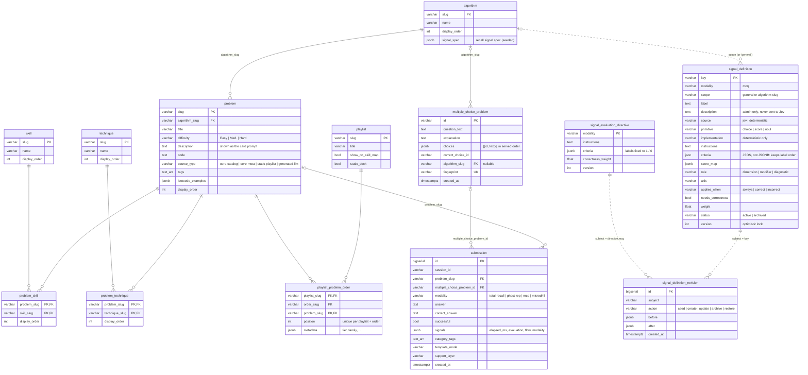

# Database schema

Postgres. The schema is built by [Alembic](https://alembic.sqlalchemy.org/) migrations written as raw SQL in [`backend/app/migrations/versions/`](../backend/app/migrations/versions/); there are no ORM models. Revision `0001` is the baseline ([`0001_baseline.sql`](../backend/app/migrations/versions/0001_baseline.sql), frozen), and each later revision is one change on top of it. Startup (`connect()` in `backend/app/database.py`) takes a Postgres advisory lock, runs `alembic upgrade head`, seeds the catalog if it changed, and seeds any missing default MCQ signals. See [Migrations](#migrations) below.

The tables fall into three groups:

- **Content catalog:** what you practice. Seeded from code at boot whenever the code catalogs change.
- **Practice records:** what you did. Written by `POST /api/attempts`.
- **Signal registry:** how MCQ answers are graded by Jev. Seeded once (insert-if-missing), then owned by `/admin`.

## Entity relationships

Solid lines are foreign keys. Dotted lines are references by value that the database does not enforce.



## Content catalog

| Table | Holds | Written by |
|---|---|---|
| `algorithm` | One row per algorithm family (sliding window, heap, …). `signal_spec` is the recall signal spec used by the legacy LLM evaluators. | Seed (overwrites) |
| `problem` | A practice card: its code, description (served as the prompt), hint and tags. Every problem belongs to one algorithm. | Seed |
| `skill`, `technique` | Finer-grained labels. | Seed |
| `problem_skill`, `problem_technique` | Many-to-many links from problems to skills and techniques. | Seed |
| `playlist`, `playlist_problem_order` | Ordered decks of problems. A playlist can have several named orders (`order_slug`). | Seed |
| `multiple_choice_problem` | A generated MCQ: its `choices` array (four `{id, text}` objects, in served order), the answer key (`correct_choice_id`), and the algorithm it was generated for (`algorithm_slug`, when known). `fingerprint` deduplicates identical questions. MCQ grading scopes signals by `algorithm_slug`, falling back to the submission's tags. | Generated during practice |

### Content rules

- **`problem` is the single home for practice content:** core algorithms, meta questions, static playlist cards and generated cards. Do not add another table that stores titles, prompts, code, difficulty or tags; the architecture tests guard this.
- **`source_type` records where a row came from:** `core-catalog`, `core-meta`, `static-playlist` or `generated-llm`. Generated cards are written straight to `problem`, with `generation_context` (which also records `llmUsed`).
- **Playlists only organize:** `playlist` and `playlist_problem_order` reference problems by slug and never copy their content.
- **Submissions keep a snapshot:** `submission.generated_card` stores the card exactly as shown, so history renders correctly even if the problem later changes.
- **Resetting practice history** deletes `generated-llm` problems but never core or playlist rows.
- **MCQs are separate on purpose:** they live in `multiple_choice_problem`. A stored question is never edited, so every MCQ answer can be checked against what was shown.
- The Python and TypeScript catalogs in code (`backend/app/core/*catalog*.py`, `src/data/`) are seed inputs and offline fallbacks; reads at runtime go through the repositories.
- **Seeding is skipped when nothing changed:** the seed hashes the code catalogs plus the seeding code and stores the hash in `seed_state` (key `catalog`). A boot with a matching hash writes nothing. To force a reseed, `DELETE FROM seed_state WHERE key = 'catalog'` and restart.
- **Retired core problems that have submissions are kept:** `submission.problem_slug` is `ON DELETE RESTRICT`, so the seed skips deleting them and logs a warning instead of failing the boot.

## Practice records

`submission` is the only table practice writes to. One row per answer, across every modality.

- `modality` picks the evaluator (see [data-flow.md](data-flow.md)).
- `problem_slug` links recall-style answers to a catalog problem. `multiple_choice_problem_id` links MCQ answers to their question.
- `signals` is a JSONB object, and a CHECK constraint allows only these keys:
  - `elapsed_ms` (required, a number)
  - `evaluation`: the canonical evaluation. For MCQ this includes `signalResults`, `correctness`, `provenance`, `jevTrace` and a `signalSpecSnapshot`, so a stored grade can always be explained even after the signals change.
  - `flow`: flow-mode bookkeeping (`anchorCardId`, …)
  - `modality`: modality-specific extras
- The Dashboard and Journey pages read from this table. The Journey day view groups rows by date in the viewer's time zone.

## Signal registry

These three tables make MCQ grading data-driven. See [backend-architecture.md](backend-architecture.md) for the code side.

- **`signal_definition`:** one row per signal. A signal is either a Jev question (`source = 'jev'`, with a `primitive`) or a deterministic implementation registered in code (`source = 'deterministic'`, with an `implementation` such as `completionTime`). The `signal_definition_source_fields_check` constraint enforces that split.
  - `scope` is `general` (applies to every MCQ) or an algorithm slug (applies only to that algorithm's MCQs). It is checked in code, not by a foreign key.
  - Signals are archived, never deleted: past evaluations refer to their keys.
  - Every write must send the current `version`. A stale version is a 409.
- **`signal_evaluation_directive`:** the correctness question for a modality. Its wording and weight are editable; its labels are always `"1"` and `"0"`.
- **`signal_definition_revision`:** an append-only log of every seed, create, update, archive and restore, with before and after snapshots. `subject` is a signal key, or `directive:<modality>` for the correctness question.

The evaluator reads the active definitions on every MCQ submission, so an edit in `/admin` applies to the next answer without a restart.

## Migrations

Alembic, raw SQL, on the app's asyncpg driver (`postgresql+asyncpg`). Files:

- `backend/alembic.ini`: CLI config. The URL comes from `DATABASE_URL` (`app.config.settings`).
- `backend/app/migrations/env.py`: async environment; holds a transaction-level advisory lock while upgrading, and runs every pending revision in one transaction.
- `backend/app/migrations/versions/`: one file per revision. `execute_script()` (from `app/migrations/runner.py`) runs a multi-statement SQL string, `DO $$` blocks included.
- `alembic_version`: the applied revision, managed by Alembic.

The app upgrades to head on every start, so in normal use you never run Alembic by hand. To change the schema:

```bash
cd backend
alembic revision -m "add foo to bar" --rev-id 0008   # next number in sequence
# write the SQL in upgrade() (and downgrade() if it is reversible)
alembic upgrade head                                 # or just restart the backend
alembic current                                      # which revision a database is on
```

Rules:

- **Never edit an applied revision** (the baseline included). Add a new one.
- **Write revisions to be safe if their change already exists** (`IF NOT EXISTS`, `IF EXISTS`, guarded `UPDATE`s), so databases that predate a change, or were patched by hand, upgrade cleanly.
- **Keep data fixes in revisions, not in startup code:** a revision runs once per database; startup code runs on every boot.
- Revision numbers are zero-padded and sequential (`--rev-id`), so `versions/` reads in order.

Databases created before Alembic need nothing special: the baseline is all `IF NOT EXISTS`, and revisions `0002`–`0006` replay the old in-place upgrades (add `algorithm.signal_spec`, drop `submission.migration_key`, stamp evaluations missing `signalSpec`, add `signal_definition.description`, backfill `submission.problem_slug`). `0007` adds `seed_state`.

Cleanup revisions:

- **`0008`** drops columns nothing read: `submission.user_id`, `target_source`, `target_control`, `format_control` and `updated_at`; `problem.prompt` and `llm_used`; `playlist_problem_order.tier` and `family`. It also drops unused submission indexes, and adds an expression index for the card-id lookup.
- **`0009`** normalizes `multiple_choice_problem`:
  - the choices become one `choices` array, and the answer key is stored once;
  - `question_help_text` is renamed `explanation`;
  - timestamps become `TIMESTAMPTZ`;
  - a nullable `algorithm_slug` links each MCQ to its algorithm.
