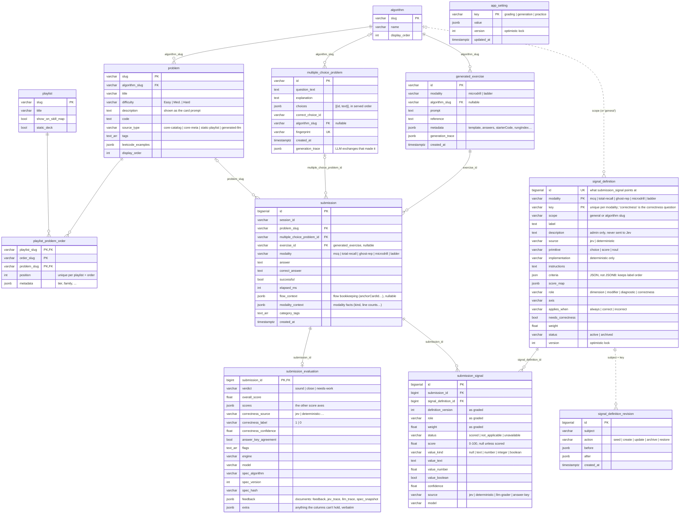

# Database schema

Postgres. The schema is built by [Alembic](https://alembic.sqlalchemy.org/) migrations written as raw SQL in [`backend/app/migrations/versions/`](../backend/app/migrations/versions/); there are no ORM models. Revision `0001` is the baseline ([`0001_baseline.sql`](../backend/app/migrations/versions/0001_baseline.sql), frozen), and each later revision is one change on top of it. Startup (`connect()` in `backend/app/database.py`) takes a Postgres advisory lock, runs `alembic upgrade head`, seeds the catalog if it changed, and seeds any missing default signals for every modality. See [Migrations](#migrations) below.

The tables fall into three groups:

- **Content catalog:** what you practice. Seeded from code at boot whenever the code catalogs change.
- **Practice records:** what you did. Written by `POST /api/attempts`.
- **Signal registry and settings:** how every modality's answers are graded, and the server-side grading, generation and practice settings. Signals are seeded once (insert-if-missing), then owned by `/admin`. See [grading.md](grading.md).

## Entity relationships

Solid lines are foreign keys. Dotted lines are references by value that the database does not enforce.



## Content catalog

| Table | Holds | Written by |
|---|---|---|
| `algorithm` | One row per algorithm family (sliding window, heap, …). Signals scoped to an algorithm refer to its slug. | Seed (overwrites) |
| `problem` | A practice card: its code, description (served as the prompt), hint and tags. Every problem belongs to one algorithm. | Seed |
| `playlist`, `playlist_problem_order` | Ordered decks of problems. A playlist can have several named orders (`order_slug`). | Seed |
| `multiple_choice_problem` | A generated MCQ: its `choices` array (four `{id, text}` objects, in served order), the answer key (`correct_choice_id`), and the algorithm it was generated for (`algorithm_slug`, when known). `fingerprint` deduplicates identical questions. `generation_trace` holds the LLM exchanges that generated it (prompt, payload, reply, usage, timing, failed attempts); `[]` for questions made before migration 0010. MCQ grading scopes signals by `algorithm_slug`, falling back to the submission's tags. | Generated during practice |
| `generated_exercise` | A generated microdrill or Ladder rung: the task (`prompt`), the correct solution (`reference`), modality details in `metadata` (a microdrill's template and blank answers; a rung's starter code, technique and index) and `generation_trace`. | Generated during practice |

### Content rules

- **`problem` is the single home for practice content:** core algorithms, meta questions, static playlist cards and generated cards. Do not add another table that stores titles, prompts, code, difficulty or tags; the architecture tests guard this.
- **`source_type` records where a row came from:** `core-catalog`, `core-meta`, `static-playlist` or `generated-llm`. Generated cards are written straight to `problem`, with `generation_context` (which also records `llmUsed`).
- **Playlists only organize:** `playlist` and `playlist_problem_order` reference problems by slug and never copy their content.
- **Submissions keep a snapshot:** `submission.generated_card` stores the card exactly as shown, so history renders correctly even if the problem later changes.
- **Resetting practice history** deletes `generated-llm` problems but never core or playlist rows.
- **MCQs and generated exercises are separate on purpose:** they live in `multiple_choice_problem` and `generated_exercise`. A stored item is never edited, so every answer is graded against what was shown.
- The Python and TypeScript catalogs in code (`backend/app/core/*catalog*.py`, `src/shared/data/`) are seed inputs and offline fallbacks; reads at runtime go through the repositories.
- **Seeding is skipped when nothing changed:** the seed hashes the code catalogs plus the seeding code and stores the hash in `seed_state` (key `catalog`). A boot with a matching hash writes nothing. To force a reseed, `DELETE FROM seed_state WHERE key = 'catalog'` and restart.
- **Retired core problems that have submissions are kept:** `submission.problem_slug` is `ON DELETE RESTRICT`, so the seed skips deleting them and logs a warning instead of failing the boot.

## Practice records

`submission` is the only table practice writes to. One row per answer, across every modality.

- `modality` picks the context builder and signal spec the grading pipeline uses (see [grading.md](grading.md)).
- `problem_slug` links recall-style answers to a catalog problem. `multiple_choice_problem_id` links MCQ answers to their question. `exercise_id` links microdrill and Ladder answers to their stored exercise.
- `elapsed_ms`, `flow_context` (flow bookkeeping: `anchorCardId`, run, stage…) and `modality_context` (modality facts: line counts, the chosen option…) describe how the answer was given.
- **`submission_evaluation`** (one row per graded submission) holds the evaluation's facts as columns: verdict, overall score (other score axes in `scores`), who decided correctness and with what label and confidence, answer-key agreement, flags, engine and model, and the spec reference. Feedback, the Jev and LLM traces and the spec snapshot are JSONB documents, read whole. `extra` keeps anything the columns can't express, verbatim, so nothing an old evaluation stored is lost.
- **`submission_signal`** (one row per signal per graded submission) points at its `signal_definition` and records the `definition_version`, `role` and `weight` it was graded with; its `status` (scored, not applicable or unavailable); its 0–100 `score`; the raw answer in one typed column (`value_text`, `value_number` or `value_boolean`, named by `value_kind`; a check allows at most one); `confidence`, `note` and `evidence`; and who produced it (`source`: `jev`, `deterministic`, `llm-grader` for the retired LLM grader, or `answer-key`) and `model`. The correctness result is a row too (its definition is the modality's `correctness` row). `grade`, `rubric_placement`, `in_results`, `position` and `extra` let the evaluation JSON be rebuilt exactly.
- Readers never assemble the JSON themselves: `submission_signal_repository.fetch_evaluations` / `attach_signals` rebuild it with `contracts/evaluation_rows.join_evaluation`, and writes split it with `split_evaluation`. Evaluations stored before the pipeline (LLM-assessed recall) are rows like any other, with `source = 'llm-grader'`.
- The Journey page reads from this table. The Journey day view groups rows by date in the viewer's time zone.

## Signal registry and settings

These tables make grading data-driven for every modality. See [backend-architecture.md](backend-architecture.md) for the code side.

- **`signal_definition`:** one row per signal, keyed by `(modality, key)`, so modalities can share keys with the same meaning (`nearMiss`, `completionTime`). A signal is either a Jev question (`source = 'jev'`, with a `primitive`) or a deterministic implementation registered in code (`source = 'deterministic'`, with an `implementation` such as `completionTime`). The `signal_definition_source_fields_check` constraint enforces that split.
  - `scope` is `general` (applies to every item of the modality) or an algorithm slug (applies only to that algorithm's items). It is checked in code, not by a foreign key.
  - Signals are archived, never deleted: past evaluations refer to their keys.
  - Every write must send the current `version`. A stale version is a 409.
  - Each modality's **correctness question** is its `correctness` row (role `correctness`): wording, weight and `source` (`jev`, or `deterministic` to let the modality's exact check decide) are editable through Admin's correctness editor; its labels are always `"1"` and `"0"`. It never appears in the signal lists.
  - Signal keys found in old evaluations with no definition (the retired LLM grader's `syntax`) have **archived** definitions, so every stored signal points at one.
- **`signal_definition_revision`:** an append-only log of every seed, create, update, archive and restore, with before and after snapshots. `subject` is `<modality>:<key>`, so the correctness question's history is `<modality>:correctness`.

- **`app_setting`:** one JSON document per settings section (`grading`, `generation`, `practice`), validated by `services/app_settings_service.py` and versioned like signals (409 if stale). A missing section uses the defaults.

The pipeline reads the active definitions and settings on every submission, so an edit in `/admin` applies to the next answer without a restart.

## Migrations

Alembic, raw SQL, on the app's asyncpg driver (`postgresql+asyncpg`). Files:

- `backend/alembic.ini`: CLI config. The URL comes from `DATABASE_URL` (`app.config.settings`).
- `backend/app/migrations/env.py`: async environment; holds a transaction-level advisory lock while upgrading, and runs every pending revision in one transaction.
- `backend/app/migrations/versions/`: one file per revision. `execute_script()` (from `app/migrations/runner.py`) runs a multi-statement SQL string, `DO $$` blocks included.
- `alembic_version`: the applied revision, managed by Alembic.

The app upgrades to head on every start, so in normal use you never run Alembic by hand. To change the schema:

```bash
cd backend
alembic revision -m "add foo to bar" --rev-id 0008   # next number in sequence
# write the SQL in upgrade() (and downgrade() if it is reversible)
alembic upgrade head                                 # or just restart the backend
alembic current                                      # which revision a database is on
```

Rules:

- **Never edit an applied revision** (the baseline included). Add a new one.
- **Write revisions to be safe if their change already exists** (`IF NOT EXISTS`, `IF EXISTS`, guarded `UPDATE`s), so databases that predate a change, or were patched by hand, upgrade cleanly.
- **Keep data fixes in revisions, not in startup code:** a revision runs once per database; startup code runs on every boot.
- Revision numbers are zero-padded and sequential (`--rev-id`), so `versions/` reads in order.

Databases created before Alembic need nothing special: the baseline is all `IF NOT EXISTS`, and revisions `0002`–`0006` replay the old in-place upgrades (add `algorithm.signal_spec`, drop `submission.migration_key`, stamp evaluations missing `signalSpec`, add `signal_definition.description`, backfill `submission.problem_slug`). `0007` adds `seed_state`.

Cleanup revisions:

- **`0008`** drops columns nothing read: `submission.user_id`, `target_source`, `target_control`, `format_control` and `updated_at`; `problem.prompt` and `llm_used`; `playlist_problem_order.tier` and `family`. It also drops unused submission indexes, and adds an expression index for the card-id lookup.
- **`0009`** normalizes `multiple_choice_problem`:
  - the choices become one `choices` array, and the answer key is stored once;
  - `question_help_text` is renamed `explanation`;
  - timestamps become `TIMESTAMPTZ`;
  - a nullable `algorithm_slug` links each MCQ to its algorithm.
- **`0010`** adds `multiple_choice_problem.generation_trace`.

The unified grading pipeline:

- **`0011`** opens the signal registry to every modality:
  - `signal_definition` is keyed by `(modality, key)`;
  - revision subjects become `<modality>:<key>`;
  - `signal_evaluation_directive.correctness_source` is added;
  - `submission.modality` allows `ladder`.
- **`0012`** adds `generated_exercise` and `submission.exercise_id`.
- **`0013`** adds `app_setting`, and drops `algorithm.signal_spec` (recall signals are `signal_definition` rows now).
- **`0014`** removes the seeded `problem_skill`, `problem_technique`, `skill`, and `technique` tables. Core problems keep their algorithm family and general tags; no submission referenced those tables.
- **`0015`** backfills legacy MCQ, exercise, and ghost rep modalities, then removes `submission.question_type`, `template_mode`, and `support_layer` with their indexes. Daily-work reads use the `skill-map` tag; practice history uses card IDs, flow anchors, and tags.

Relational signals:

- **`0016`** adds `signal_definition.id` and the `correctness` role, turns each `signal_evaluation_directive` row into a `correctness` definition (same version; history moves to `<modality>:correctness`), archives definitions for orphan keys in old evaluations, creates `submission_evaluation` and `submission_signal`, adds `submission.elapsed_ms`, `flow_context` and `modality_context`, and backfills all of them by splitting each stored evaluation with the app's own `split_evaluation`.
- **`0017`** checks, from the JSON itself, that every evaluation has its row and every signal its row (it stops the upgrade if not), then drops `submission.signals` and `signal_evaluation_directive`.
